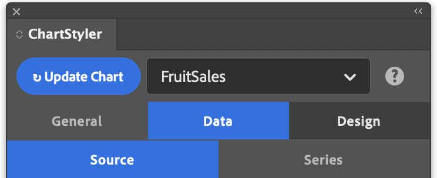

# Data

The **Data** tab connects the chart to its data and tells ChartStyler how to read it. It has two sub-tabs:

- [Source](data-source.md): select the table or CSV file that holds the chart data, or add a new one.
- [Series](data-series.md): describe how the data is arranged, reorder series, set number handling, and group data points.
