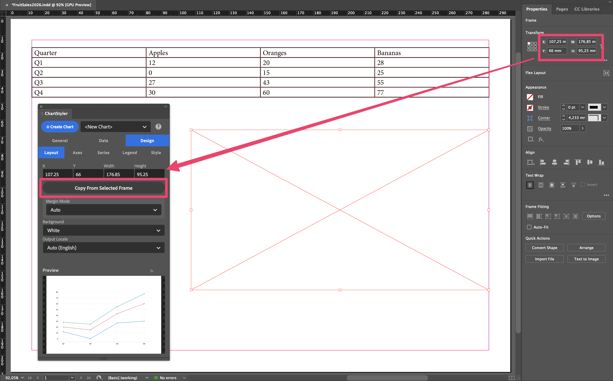
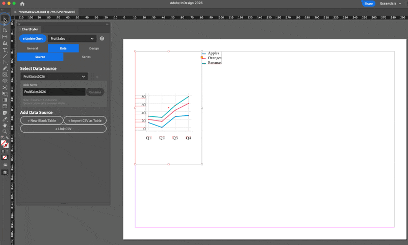
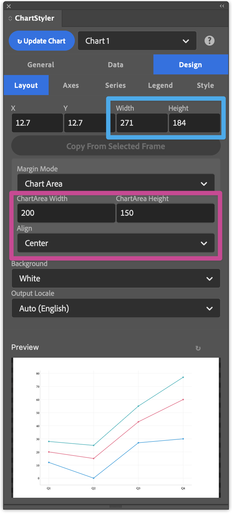
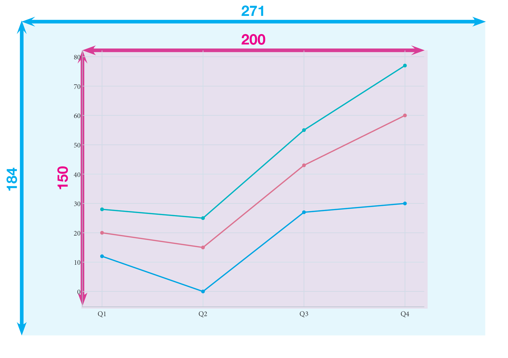
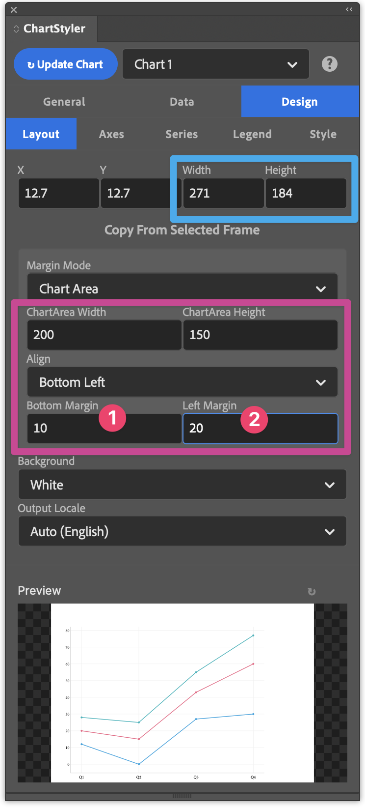
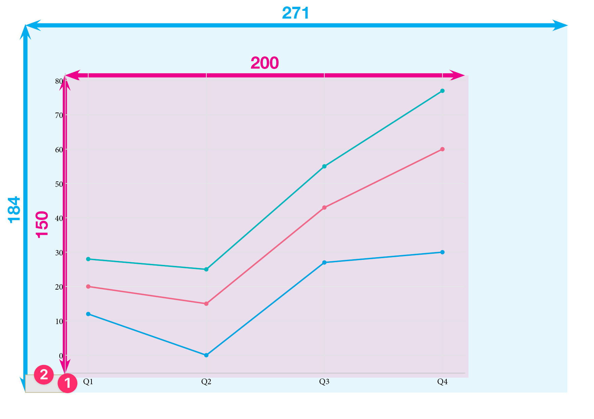
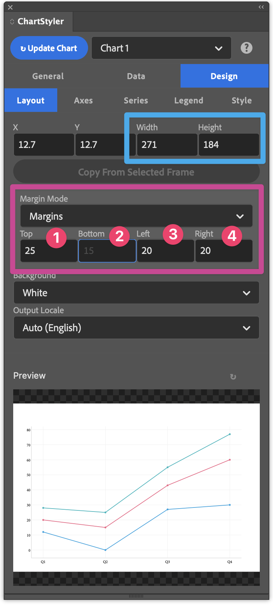
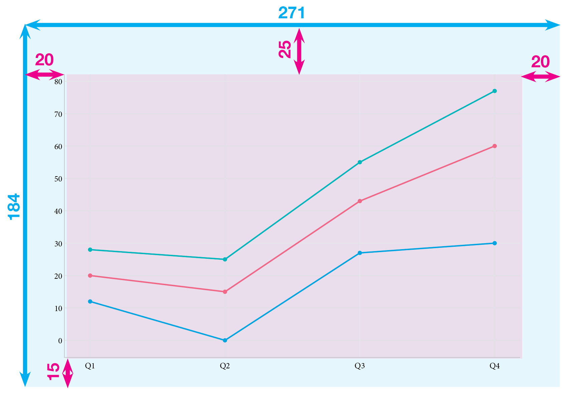

# Design → Layout

Controls where the chart is placed on the InDesign page, how large it is, and its margins.

---

## Placement of the Chart Frame

- **X / Y**: top-left origin of the chart frame in the current document units. Defaults to the page live area origin.
- **Width / Height**: dimensions of the chart frame in document units.
- **Copy From Selected Frame**: fills in the placement fields from the currently selected InDesign frame. The easiest way to place a chart is to draw a rectangle frame on the page, select it, and click this button.

The Width and the Height define the size of the chart that will be placed (in the document units) and X and Y define the place on the active page.
You can type the required values, but much easier is to simply draw a new Rectangular Frame on the page and then use the "Copy From Selected Frame" action button.

### Moving or resizing a placed chart

You can move or resize a chart that is already placed in two ways:

- **In InDesign**: move or resize the chart on the page, then click **Update Chart**. The chart is redrawn at its new position and size.
- **In the panel**: change **X**, **Y**, **Width** or **Height** (or use **Copy From Selected Frame**), then click **Update Chart**.

The fields show the chart's current position and size in InDesign. They are refreshed when you select the chart and after every update. After moving or resizing the chart in InDesign, click **↻** next to **Copy From Selected Frame** to reload them; you don't have to, because **Update Chart** uses the chart's current position and size for every field you haven't changed. Each field is handled separately: a field you changed in the panel uses the value you typed, and the other fields keep the chart's position or size from InDesign.

You can also rotate a chart in InDesign. **Update Chart** keeps the rotation. For a rotated chart, **X** and **Y** are the position of the chart's own top-left corner, and **Width** and **Height** are its size before rotation, the same values InDesign's Control panel shows with the top-left reference point selected. A legend you moved by hand moves along with the chart.

Always click **Update Chart** after resizing a chart in InDesign, so that the chart is redrawn at the new size instead of being stretched.

---

## Margins

Controls the inner plot area within the chart frame.

- **Margin Mode**
  - *Auto*: margins are determined automatically. These margins are usually quite big.
  - *Chart area*: you specify the plot width and height; the margins are derived from those.
  - *Manual*: you set each margin (top, right, bottom, left) explicitly.
- **ChartArea Width / Height** *(Chart area mode)*: size of the inner data area.
- **Align** *(Chart area mode)*: alignment of the plot area within the frame, with an offset from the edges it is aligned to.
- **Top / Bottom / Left / Right** *(Manual mode)*: individual margin values.

### Example with "Chart Area" Marging Mode

In this mode you define the size of the Chart Area and this is that placed in the Chart Object. The Chart Area is here 200 x 150 and the Alignment is set to Center. As a result the Chart Area will be centered over the Width and Height of the Chart (271 x 184)

When you select one of the other Alignments Top Left / Top Right / Bottom Left / Bottom Right then you can specify the 2 margins

The Chart Area is here 200 x 150 and it will be placed with a fixed bottom margin (1) of 10 and a fixed Left Marging (2) of 20.

### Example with "Manual" Marging Mode

In Manual Margin Mode you define one or more margins and the Chart Area is calculated automatically. In this example fixed margins have been set to Top (1), Bottom (2), Left (3) and Right (4) Margins

ChartStyler-Design-Layout-MarginMode-Manual-Preview.png

---

## Background

- **Background**: fill of the chart background rectangle. *White* by default; use *Transparent* to let the page show through.

---

## Output Locale

- **Output Locale**: controls how dates, month names, and numbers are displayed in the chart. **Auto (English)** uses English formatting. This setting affects chart display only, not how numbers are read from the table; see [Series → Processing](data-series-processing.md#decimal-separator) for decimal separators.

---

## Bar chart options

*(Visible only for Bar and Bar (Horizontal) chart types.)*

- **Bar Mode**: *Grouped* places bars side by side per category. *Stacked* stacks them.
- **Category Gap %**: space between bar clusters. Higher values create more separation between categories.
- **Bar Spacing %**: space between individual bars within a cluster. Available for grouped bars.

---

## Pie / Donut options

*(Visible only for Pie and Donut chart types.)*

- **Label Position**: where slice labels appear: *Auto*, *Inside*, *Outside*, or *None*.
- **Label Shows**: what is shown on each slice: name, percentage, value, combinations, or none.
- **Slice Explode %**: pushes slices outward by the given percentage. This also pushes outside labels further out.

---
