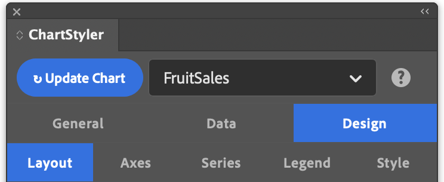

# Design

The **Design** tab controls how the chart is drawn in InDesign: where it is placed and what it looks like. It is available once a data source is selected on the **Data** tab.

It has six sub-tabs:

- [Layout](design-layout.md): placement, size, margins, background, and bar and pie options.
- [Axes](design-axes.md): axis titles, grid lines, axis range, and tick labels. Not shown for Pie and Donut charts.
- [Series](design-series.md): line, fill, marker and area styling per series.
- [Legend](design-legend.md): whether and where the legend is shown.
- [Style](design-style.md): the InDesign style groups the chart uses.
- [Palette](design-palette.md): the colours assigned to series and slices.
