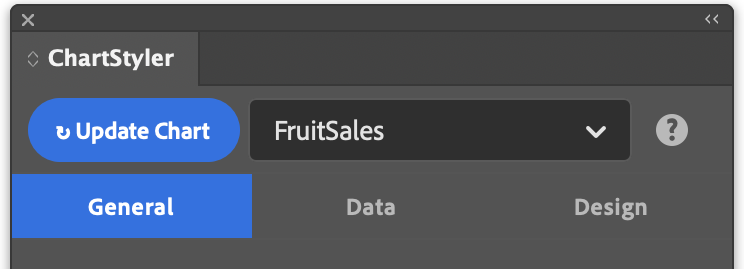

# General

The **General** tab sets what the chart is: its name and its chart type. It has no sub-tabs.

---

## Chart Name

Optional name used to identify the chart when there are several charts in the same document. The name appears in the chart dropdown at the top of the panel, so you can quickly select a chart to edit it. It is generated automatically if you leave it blank, and you can change it later with **Rename**.

---

## Chart Type

Selects the type of chart to create.

| Chart type | Best for | Options |
|---|---|---|
| **Line** | Trends over a continuous range, such as months or years | Markers, connect missing values |
| **Bar** | Comparing values across categories | Grouped or stacked |
| **Bar (Horizontal)** | Comparisons with long category labels or many categories | Grouped or stacked |
| **Area** | Volume or totals that build up over time | Fill to zero or stacked, fill opacity |
| **Scatter** | How two values relate, or how values are spread | Markers |
| **Donut** | Parts of a whole, with a hollow centre | Same as Pie |
| **Pie** | Parts of a whole, with a few categories | Label content and position, sorting, slice explode |

The chart type decides which options appear on the other tabs. For example, the **Markers** sub-tab under **Design → Series** is only shown for Line, Area and Scatter charts.
