# Getting started

This guide walks you through creating your first chart with ChartStyler, from getting your data into InDesign to placing a finished chart on the page.

As an example we will start of with a simple chart that shows the sales of Apples, Oranges and Bananas.

The purpose of ChartStyler is to create a chart that you can style entirely inside InDesign using the all the InDesign controls like paragraph styles and object styles and still have a way to update your source data is needed. This is a unique workflow that allows you to automate a lot of things and can save you a lot of time.

<!-- TODO: Short intro — what the reader will have built by the end (screenshot of the finished example chart). -->

---

## Before you begin

<!-- TODO:
- Requirements (InDesign version, ChartStyler installed and subscription active)
- Open or create an InDesign document
- Open the panel: Window → ChartStyler
- Screenshot of the empty panel
-->

Make sure you are running InDesign (minimun supported version at the moment is ...)
You can install the plugin from the PlugIns menu in InDesign. Use Browse Plugin and look for the ChartStyler plugin in Creative Cloud. Once you have completed the purchase/subscription you are ready to use the plugin.

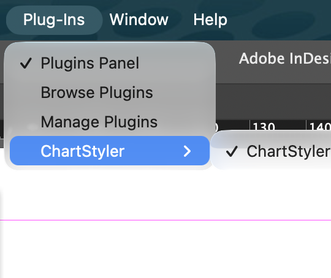

You can start the Plugin from the Plug-Ins menu or from the Plugins Panel

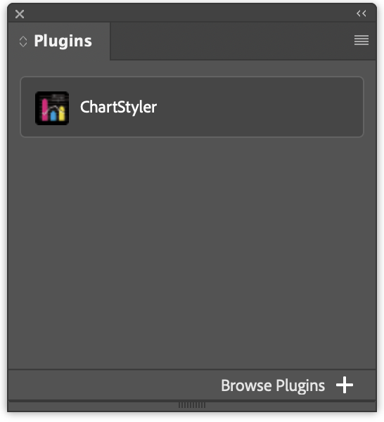

Once ChartStyler is started you should see a panel like this:

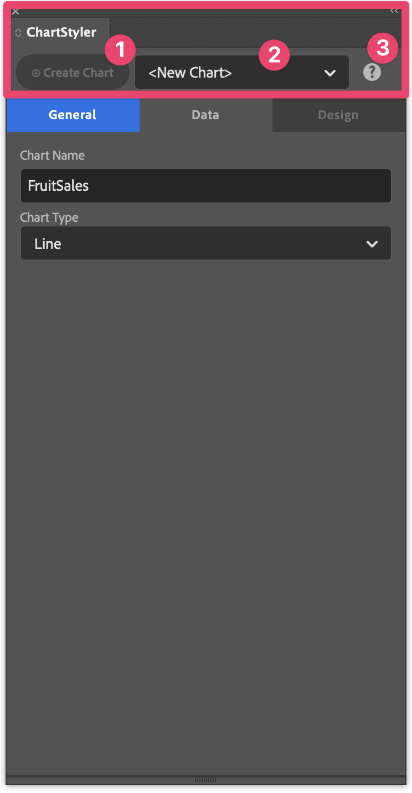

At the top left of the ChartStyler panel there is an action button (1) to Create or Update a Chart. The Create button will be enabled as soon as there is enough information to create a Chart. Next to that button there is a dropdown (2) That allows you to quicky select one of the Charts that are available in the active InDesign Document.
On the right there is a help button (3) that you can click to open the online help. Double-clicking this button reveals information about the ChartStyler plugin (such as software version number)
This Top line of the ChartStyler panel is always visible.

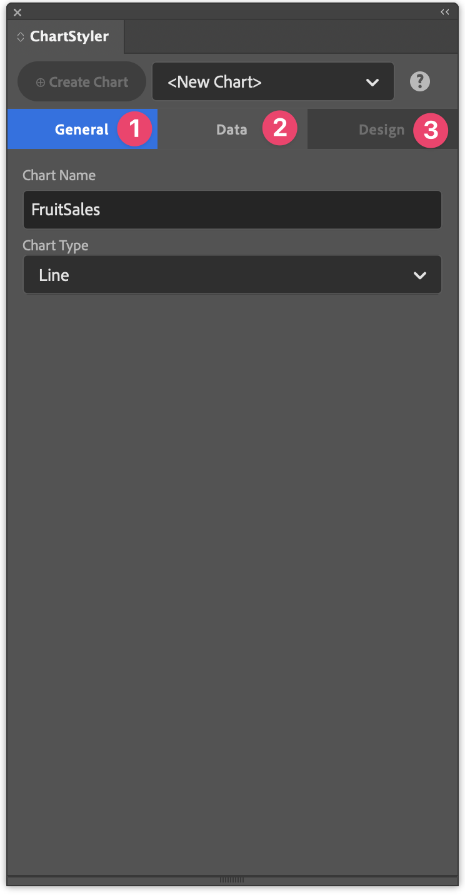

Underneath there is a multiline tab menu that act as tab sheets (the top one is General (1) / Data (2) / Design (3)) and sub tabs will appear to define extra options and settings. This tab oriented design allows you to easily make changes while keeping the plugin panel as compact as possible. On creation you will normally simply follow the tabs from left to right as a kind of wizard. Sometimes a tab is not enabled, this means that there is info missing in order to continue to the next tab. For example you cannot select the Design (3) tab when the Data (2) tab does not have a Data Source selected.

## Step 1: Chart Name and Chart Type

In the first Tab you can define the Chart Name (1). This name can be used to easily reference the Chart when you have multiple Charts in the document. Give it a short name that allows you do quickly identify the Chart.
You can later change this name if you like
You can give every Chart that you create in your document a Name, that makes it easy to select the Chart in ChartStyler to make changes. You can have multiple Charts in your document, and you can even copy a Chart from one InDesign Document to another.
Then you select the Chart Type (2) that you would like to create. There is a whole list of chart types that you can choose from.

| Chart type | Best for | Options |
|---|---|---|
| **Line** | Trends over a continuous range, such as months or years | Markers, connect missing values |
| **Bar** | Comparing values across categories | Grouped or stacked |
| **Bar (Horizontal)** | Comparisons with long category labels or many categories | Grouped or stacked |
| **Area** | Volume or totals that build up over time | Fill to zero or stacked, fill opacity |
| **Scatter** | How two values relate, or how values are spread | Markers |
| **Pie** | Parts of a whole, with a few categories | Label content and position, sorting, slice explode |
| **Donut** | Parts of a whole, with a hollow centre | Same as Pie |

For this example we will continue with a simple line chart to show you the process of create a chart.

---

## Step 2: Get your data into an InDesign table

### Selecting a Data Source

Important to know here is that ChartStyler has 2 different kind of data sources. 

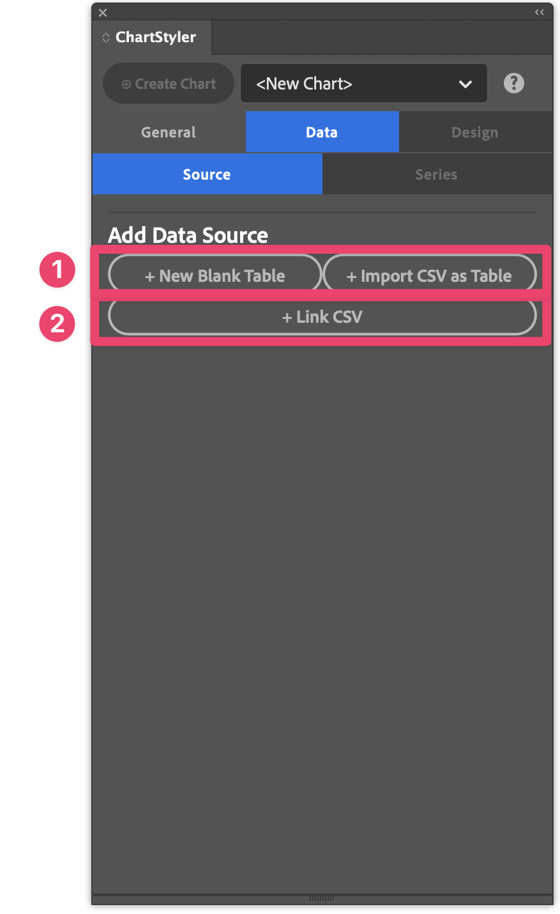

The first data source (1) is an InDesign Table. In this case ChartStyler will use a Table in the InDesign document as the data source. This is very useful when the data set is not too big. There are 2 ways to kick of the table creation, you can simply create the table using the "+ New Blank Table" action or you can point to a CSV (text-delimited file) to create a table.
In both these cases the Data Source will be the InDesign Table and you can modify the values inside InDesign. The table is part of the InDesign document and as a result the data is also stored in the InDesign document.

The second possible option (2) is to use a CSV file directly as a Data Source for the chart. Here we will link to a csv file on disk and it is important that you keep a link to that file in case you want to recreate the chart. In this case you will also have to edit the values in the CSV file directly in case you want to make changes to the source data. This option is more practicle for larger datasets.

<!-- TODO: Explain that ChartStyler uses an InDesign table as its data source. Link to [Data view](data-source.md). -->

For this example we will use a simple InDesign table, click "+ New Blank Table" to create a table

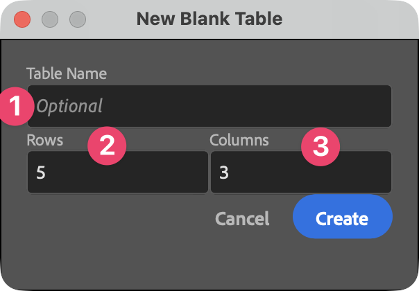

In this window you can type the Name of the Table. This will allow you to reference the same data table from different Charts. It is for example possible to create multiple charts (using different chart types) using the data from the same table.

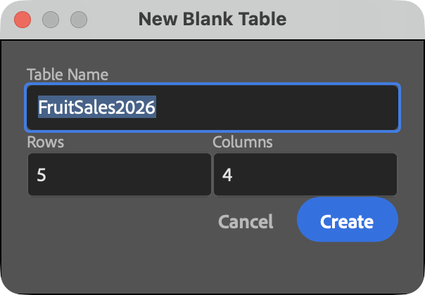

When you create this a new Data Source Table is created in your InDesign Document. You can type in the data in this table.

| Quarter | Apples | Oranges | Bananas |
|---|---:|---:|---:|
| Q1 | 12 | 20 | 28 |
| Q2 | 0 | 15 | 25 |
| Q3 | 27 | 43 | 55 |
| Q4 | 30 | 60 | 77 |

Note that you can also select all cells of this html table and paste them into InDesign after you selected all cells of the InDesign table. This shows you that you can easily copy data from other Applications (such as tables in browsers or Excel) to InDesign.

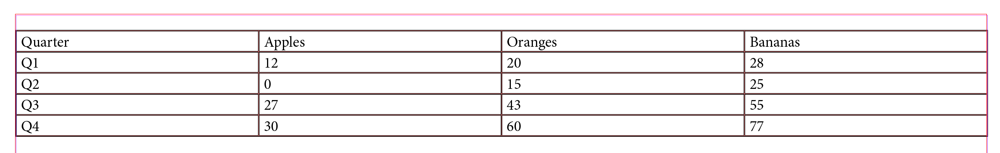

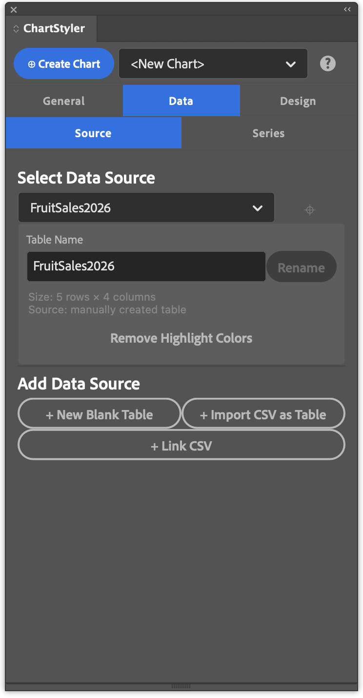

You can see that this Chart is now using the InDesign table named 'FruitSales2026' as a data source. This now contains all the data that can be used for our chart. It is a true InDesign table, that means that you can edit the values, add columns and rows if you like. This table can be part of the printed content in your InDesign document or you can add it to a hidden layer if you like...

You will notice that once the Source is selected you are able to navigate to the 'Series' tab. As you can see even the "Create Chart" action button is already available. If you are happy with the default data organization then this will already be enough to create your first Chart. For this example we will first walk through the other tab options to help you understand what controls are available in ChartStyler.

### Organizing your Data (Series/Values)

The next step is to define how your data will translate to the chart. A data series is a set of related values that are drawn together in the chart, such as the quarterly sales figures. Each series gets its own line, set of bars, area or group of points, with its own colour and an entry in the legend. In your table, a series is usually one column (or one row), and its name comes from the header cell.

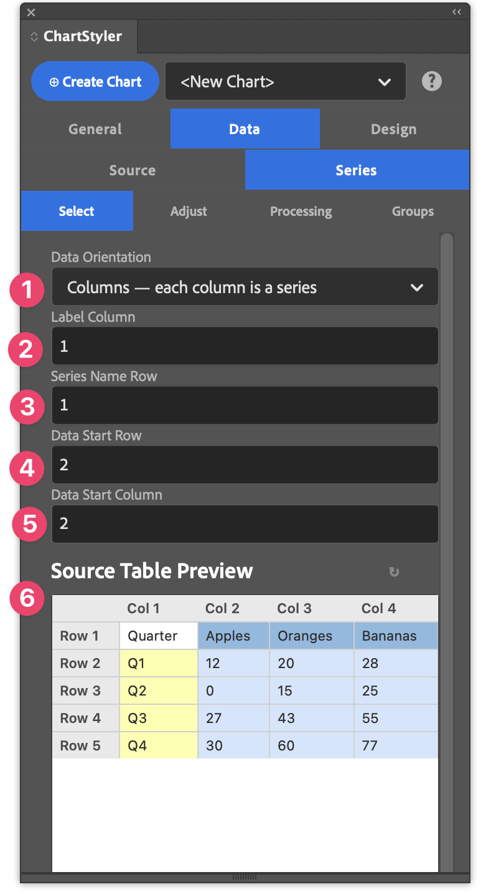

In this example we want to plot the sales of Apples,Oranges and Bananas. These are our Data Series. The values of these sales results are organized in columns, that is why we will select the "Columns - each column is a series" option.
So the Data Orientation (1) depends on how the data is stored in you Data Source and what you want to create a Chart.
Once that is defined there a some more controls to define what the data represents

- **Label Column** (2): the column that holds the category labels, such as the quarters (Q1, Q2, Q3, Q4) in this example. These labels appear along the horizontal X axis.
- **Series Name Row** (3): the row that holds the name of each series. These names appear in the legend.
- **Data Start Row** (4): the first row that contains values. Rows above it, such as the header row, are not plotted.
- **Data Start Column** (5): the first column that contains values. Columns to its left, such as the label column, are not plotted.

For this example we don't have to change anything. Note that the "Source Table Preview" will help you understand what data is being used. In the "Source Table Preview" you will see the series data in light blue, the Series Labels in dark blue and the category labels in yellow.

Once that Selection is made we can proceed to the next tab 'Adjust'. Here you can reorganize the order of the series itself without actually changing the data in the data source.

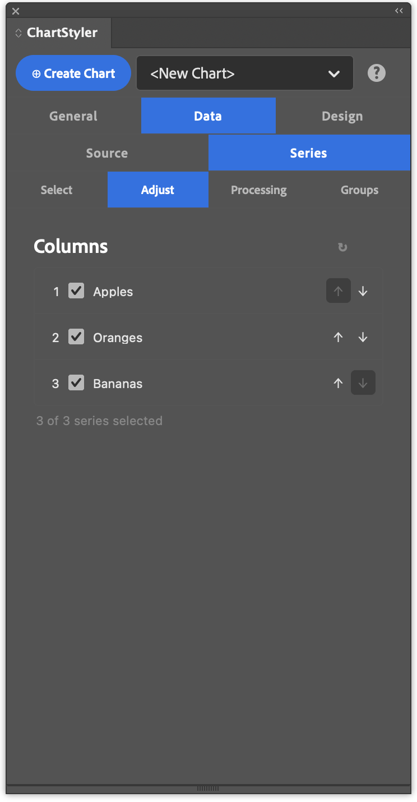

The defaults are good here for our data and can proceed to the 'Processing' tab

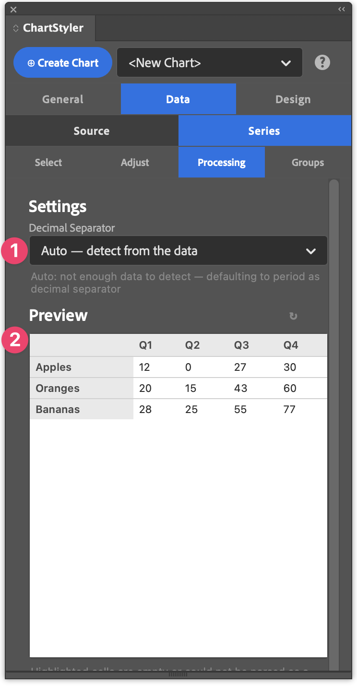

In the 'Processing' tab we can control the decimal Separator (1) that is used for our values. There is an Automatic setting that will work most of the time, but you can also set it explicitly to Period or Comma.

Below you can find a Preview (2) of the Series data that will be used for the Chart.
What pieces of the data do you want to use and what are the series.

We are happy with that selection and we can skip the Groups tab for this example and go straight from the main 'Data' tab to the 'Design' tab.

## Step 3: Designing the Chart

The 'Design' tab is all about how the Chart will be drawn in InDesign. Where will it be added and what elements will it contain and how does it look.

### Layout

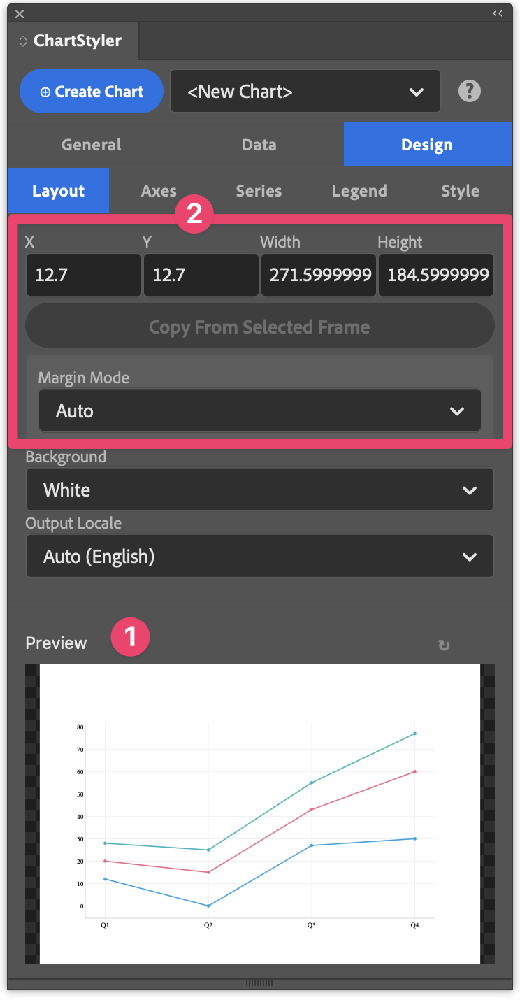

You will see that at the bottom there is already a Preview (1) of what the Chart looks like. The Preview gives you a good approximation of what the chart will look like. It will not show any custom styling done in InDesign using Paragraph Styles or Object Styles. It only shows the chart area (not the legend).

For this example we will focus on the positioning of the chart (2). The Width and the Height define the size of the chart that will be placed (in the document units) and X and Y define the place on the active page.
You can type the required values, but much easier is to simply draw a new Rectangular Frame on the page and then use the "Copy From Selected Frame" action button.

Note that you can also first place the Chart and then simply change the size and update/redraw the Chart.

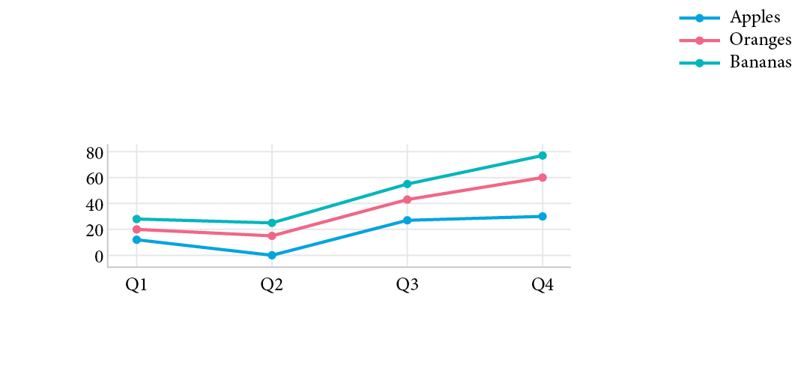

<!-- TODO:
- Link to page with detailed description of all options
-->

Note that you can modify the data in the InDesign table and simply click the 'Update Chart' action button to update the chart

---

## Step 4: Adjust the design

<!-- TODO: One short paragraph per tab, each linking to its reference page. -->

<!-- TODO: Placement, size, margins, background. See [Design: Layout](design-layout.md). -->

### Axes

<!-- TODO: Axis labels, number formats, grid lines. See [Design: Axes](design-axes.md). -->

### Series

<!-- TODO: Colors, color groups, markers, line width. See [Design: Series](design-series.md). -->

### Legend

<!-- TODO: Show/hide, position. See [Design: Legend](design-legend.md). -->

### Style

<!-- TODO: Style groups and parent style groups. See [Design: Style](design-style.md). -->

---

## Step 7: Update your chart

<!-- TODO:
- Select an existing chart to edit it in the panel
- Change settings and click Update Chart
- Change the table data (or Reload from CSV File) and redraw
-->

---

## Step 8: Fine-tune with InDesign styles

<!-- TODO:
- Charts are native InDesign objects styled with object and paragraph styles
- Edit styles in the Paragraph Styles / Object Styles panels
- Link to [Object styles reference](object-styles.md)
-->

---

## Next steps

<!-- TODO: Links to deeper topics:
- [Data point groups](data-series-groups.md) — highlight individual points or bars
- [Parent style groups](design-style.md#parent-style-group) — share typography across charts
- [Object styles reference](object-styles.md)
-->
