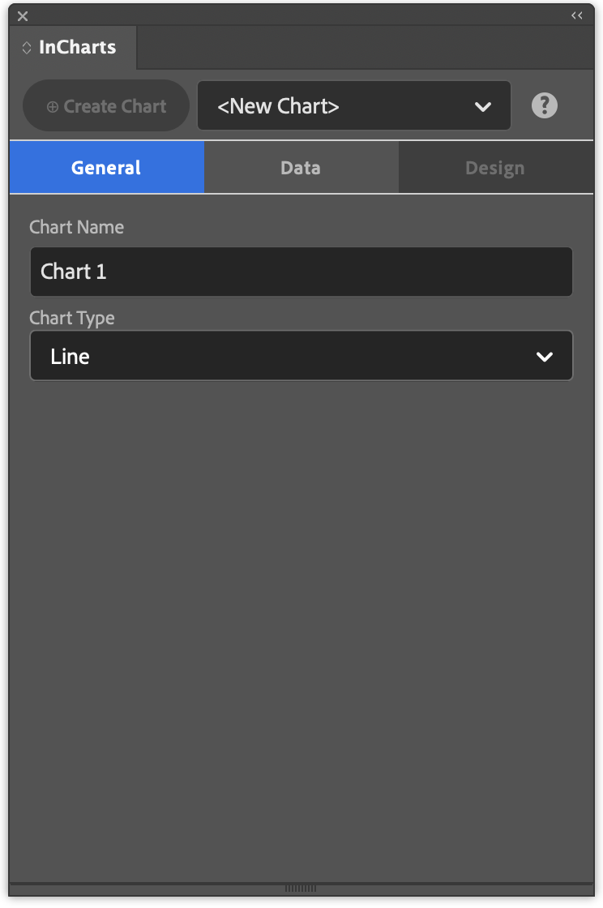

# ChartStyler

ChartStyler is an Adobe InDesign plugin that generates print-quality charts directly from InDesign tables. Charts are placed as native InDesign objects — lines, shapes, and text frames — styled through InDesign's own object and paragraph style system.

The tool allows you to quickly create and adjust charts that are mathematically correct and still have the ability to change them when needed.
There are essentially 2 steps when creating the chart. First step is to import the data in InDesign. We are using an InDesign table as a source for the chart creation. You can either copy the data straight into an InDesign table (for example copy/paste from Excel) or you can use the CSV import function to import raw comma separated data. There is even an easy way to reload or update the data from a CSV file.

The InDesign table is a great data source because you can easily modify and review the data that are behind a chart. If you don't want to print the chart make sure it is out of the page area or on a non-printing layer.

The second step is creating the chart, this starts by selecting the type of chart that you want to create. ChartStyler currently supports Line, Bar, Bar (Horizontal), Area, Scatter, Pie, and Donut charts. Then you select the table that you want to use as a Data Source. Each ChartStyler Table has a table name that you can change to better describe the data in the table. Once the table is selected you have options (in Series) that describe how to use the data in the table to create the chart.

## Quick start

1. Open the ChartStyler panel (**Plug-Ins → ChartStyler**).
2. On the **General** tab, choose the chart type and, if needed, enter a chart name.
3. On the **Data → Source** tab, select a data source, or create a blank table or import a CSV with your data.
4. On the **Data → Series** tab, configure the data layout (orientation, labels, series names).
5. Switch to the **Design** tab to choose the layout, axes, series styles, legend and palette.
6. Click **Create Chart** (⊕) to place the chart on the active page.

## Panel overview

The documentation follows the tabs of the ChartStyler panel. The **?** button in the panel opens the page for the tab you are on.

- [General](general.md): chart name and chart type
- [Data](data.md)
  - [Source](data-source.md): select or add a data source
  - [Series](data-series.md)
    - [Select](data-series-select.md): data orientation, labels, series names, where the values start
    - [Adjust](data-series-adjust.md): reorder, include or exclude series
    - [Processing](data-series-processing.md): decimal separator and data preview
    - [Groups](data-series-groups.md): group data points to style them separately
- [Design](design.md)
  - [Layout](design-layout.md): placement, margins, bar and pie options, background
  - [Axes](design-axes.md): custom number and date formats
    - [Grid](design-axes-grid.md): axis titles, grid and axis lines, Y-axis range
    - [X Ticks](design-axes-x-ticks.md): X-axis tick labels
    - [Y Ticks](design-axes-y-ticks.md): Y-axis tick labels
  - [Series](design-series.md): series selector
    - [Lines](design-series-lines.md): line width, line colour, bar fill
    - [Markers](design-series-markers.md): marker shape, size and colour
    - [Area](design-series-area.md): area style and opacity
  - [Legend](design-legend.md): position, layout, title
  - [Style](design-style.md): style group, parent style group
  - [Palette](design-palette.md): chart palette and colour groups

## Also in this documentation

- [Getting started](getting-started.md): step-by-step guide to creating your first chart
- [Object styles reference](object-styles.md): all generated InDesign object and paragraph styles
- [FAQ](faq.md): answers to common questions
